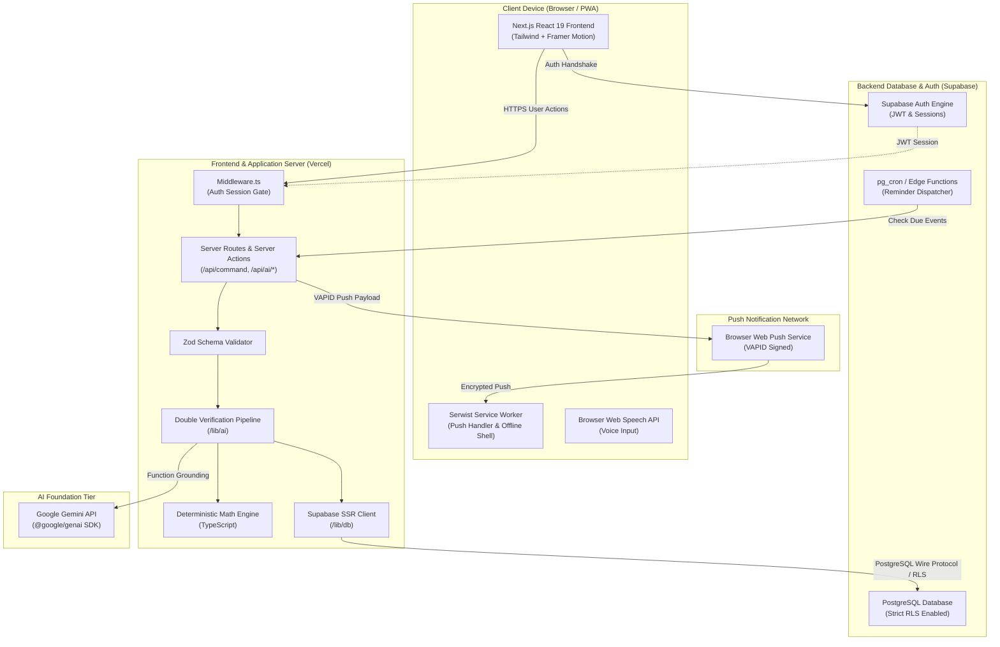
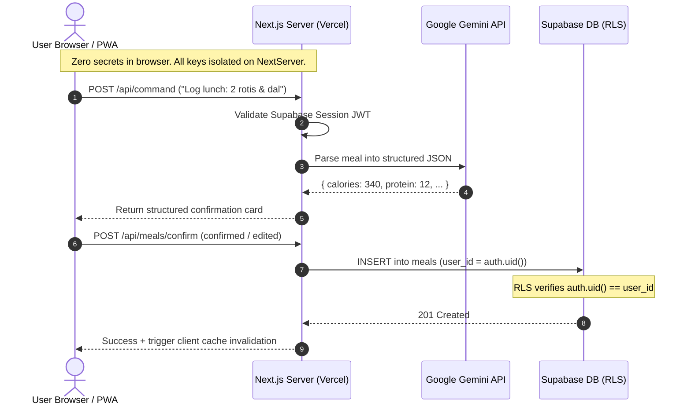

# Architecture Diagram & Deployment Joining Guide - Lucy

This document provides visual architectural diagrams and a step-by-step operational guide for deploying the **Backend** (Supabase), deploying the **Frontend** (Next.js on Vercel), and securely joining them.

---

## 1. Visual Architecture Diagrams

### 1.1 Complete System Topology


---

### 1.2 Data Join & Security Boundary Diagram


---

## 2. Step-by-Step Blueprint: Deploy Backend, Deploy Frontend & Join Them

```
+-----------------------------------------------------------------------------------+
|  STEP 1: Deploy Backend (Supabase)                                                |
|  - Create Supabase Project                                                        |
|  - Execute Database Schema Migrations with RLS                                    |
|  - Collect Project URL, Anon Key, and Service Role Key                            |
+-----------------------------------------------------------------------------------+
                                          |
                                          v
+-----------------------------------------------------------------------------------+
|  STEP 2: Deploy Frontend (Next.js on Vercel)                                      |
|  - Push Next.js codebase to GitHub repository                                     |
|  - Connect repository to Vercel                                                   |
|  - Configure build settings (Next.js preset)                                      |
+-----------------------------------------------------------------------------------+
                                          |
                                          v
+-----------------------------------------------------------------------------------+
|  STEP 3: Join Frontend & Backend via Secure Environment Binding                   |
|  - Inject Supabase URL & Anon Key into Vercel Frontend environment                |
|  - Inject Service Role Key & Gemini API Key into Vercel Server-Only environment   |
|  - Generate and inject VAPID keys for Web Push                                    |
|  - Trigger redeploy and execute connection handshake test                         |
+-----------------------------------------------------------------------------------+
```

---

### Stage 1: Provision and Upload the Backend (Supabase)

1. **Create Supabase Project:**
   - Log in to [Supabase Console](https://supabase.com/dashboard).
   - Click **New Project** and name it `lucy-assistant`.
   - Select a region close to your primary location and set a secure database password.

2. **Execute Database Migrations:**
   - In the Supabase dashboard, navigate to the **SQL Editor**.
   - Open `/supabase/migrations/001_initial_schema.sql` from this repository.
   - Run the script. This creates all 16 tables:
     `profiles`, `events`, `meals`, `health_logs`, `workouts`, `supplements`, `supplement_logs`, `habits`, `habit_logs`, `transactions`, `budgets`, `goals_money`, `notes`, `plans`, `push_subscriptions`, and `ai_audit`.
   - **Verification:** Ensure that `ENABLE ROW LEVEL SECURITY` has run on all tables. In the Supabase Table Editor, verify that every table displays the green shield icon (RLS Active).

3. **Configure Authentication:**
   - Navigate to **Authentication -> Providers** and ensure Email/Password is enabled.
   - Under **URL Configuration**, set `Site URL` to your production domain (or temporary Vercel preview domain) and add `http://localhost:3000` to `Redirect URLs`.

4. **Collect API Credentials:**
   - Go to **Project Settings -> API**.
   - Copy the following values:
     - `Project URL`
     - `anon` `public` key
     - `service_role` `secret` key (never share or expose in browser code!)

---

### Stage 2: Provision and Deploy the Frontend (Next.js on Vercel)

1. **Initialize Git & Push to GitHub:**
   - Initialize git locally:
     ```powershell
     git init
     git add .
     git commit -m "feat: complete Phase 0 setup and documentation"
     ```
   - Create a private repository on GitHub (`lucy-ai-assistant`) and push your code:
     ```powershell
     git remote add origin https://github.com/your-username/lucy-ai-assistant.git
     git branch -M main
     git push -u origin main
     ```

2. **Import into Vercel:**
   - Log in to [Vercel](https://vercel.com).
   - Click **Add New -> Project**, then import `lucy-ai-assistant`.
   - Keep Framework Preset as **Next.js**.

---

### Stage 3: Join Backend and Frontend (Environment Variables Binding)

In Vercel's **Environment Variables** configuration (or in your local `.env.local` for development), set the following exact keys:

| Environment Variable | Where it Lives | Value / Source |
|---|---|---|
| `NEXT_PUBLIC_SUPABASE_URL` | Public (Client + Server) | Supabase Project URL (`https://xyz.supabase.co`) |
| `NEXT_PUBLIC_SUPABASE_ANON_KEY` | Public (Client + Server) | Supabase `anon` `public` key |
| `SUPABASE_SERVICE_ROLE_KEY` | **Server-Only** | Supabase `service_role` secret key |
| `GEMINI_API_KEY` | **Server-Only** | Google AI Studio Gemini API Key |
| `GEMINI_MODEL` | **Server-Only** | `gemini-2.5-flash` |
| `VAPID_PUBLIC_KEY` | Public (Client + Server) | Generated via `npx web-push generate-vapid-keys` |
| `VAPID_PRIVATE_KEY` | **Server-Only** | Generated via `npx web-push generate-vapid-keys` |

> [!CAUTION]
> **Security Audit Check:** Notice that `SUPABASE_SERVICE_ROLE_KEY` and `GEMINI_API_KEY` do **NOT** have `NEXT_PUBLIC_` prefixes. This ensures Next.js strips them completely from the browser bundle.

---

### Stage 4: Verification & Handshake Test

Once deployed, run this 4-point verification check:

1. **Auth Handshake:**
   - Visit the deployed app URL.
   - Register a test account. Check Supabase **Authentication -> Users** to verify the user record appears.
2. **RLS Data Isolation:**
   - Complete onboarding. Open browser DevTools Network tab and verify requests pass the user's JWT bearer token.
   - Verify in Supabase Table Editor that the new profile has `user_id` equal to the authenticated user's UUID.
3. **AI Pipeline Handshake:**
   - In the Command Bar, enter: *"log lunch: 2 rotis and paneer"*.
   - Verify that Gemini successfully parses the meal and returns the confirmation card without client-side API errors.
4. **Audit Logging:**
   - Inspect the `ai_audit` table in Supabase to confirm the question and parsing trace were logged.
